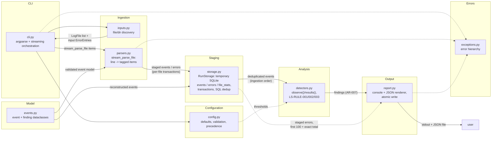

# LogSentinel — Architecture Specification

- **Document:** ARCHITECTURE.md
- **Phase:** 2 (Requirements & Technical Specification); implemented through Phase 5
  (SQLite-backed streaming architecture)
- **Status:** Implemented — this document reflects the shipped architecture

This document defines the system architecture of LogSentinel. Every design decision that
could be interpreted in more than one way is recorded as a numbered decision (**AR-0xx**)
with the selected approach and its rationale. Decisions AR-001 through AR-012 are
preserved as approved; phase addenda at the end of this document record how the
implementation evolved after approval, without rewriting the original decisions.

---

## 1. Architectural Overview

LogSentinel is a **pipeline architecture** with one-way data flow and no shared mutable
state between stages:

```
discovery -> streaming parsing -> SQLite staging -> cross-file dedup -> incremental
detection -> reporting
```

- Each stage is one module in `src/logsentinel/` (plus `storage.py`, the staging
  component).
- Modules communicate through small, typed data structures (dataclasses), streaming
  generator items, and staged SQLite rows — never through globals, singletons, or side
  channels.
- Import direction is strictly one-way (see §4), which makes every module unit-testable
  in isolation and rules out circular imports by construction.
- The process is a single streaming run: the CLI orchestrates the pipeline once, then
  exits with a code that encodes the outcome (REQUIREMENTS.md §14, FR-090).

## 2. Component Diagram



Solid arrows are the main data flow; dashed arrows are error/config flows.

## 3. Data Flow (one streaming run)

1. **CLI parse.** `cli.py` parses arguments, builds an `AppConfig` via `config.py`
   (AR-008; invalid configuration aborts with exit code 2 before any input processing,
   FR-061), and captures the run instant exactly once: `reference_now` (integer epoch
   seconds) and `generated_at` (ISO-8601 UTC) come from the same `datetime` (AR-010).
2. **Discovery.** `inputs.py` resolves the CLI paths deterministically: explicit files
   keep their supplied order and bypass the extension/hidden-name filters; directories
   are traversed in sorted order for non-hidden `*.log`/`*.txt` files (case-insensitive);
   paths are de-duplicated by exact string identity (first occurrence wins); files above
   `max_file_mb` are rejected; contents are never read. Missing, unreadable, invalid, and
   oversized paths become `ErrorEntry(kind="input")` data — discovery never raises for
   ordinary failures, and empty discovery is valid (FR-100/FR-101).
3. **Staging setup.** The orchestrator opens `RunStorage`, a temporary SQLite database
   created outside the project tree (see §14), and stages the discovery errors first so
   original error ordering starts with them.
4. **Streaming ingestion (per file, one transaction per attempt).** For each discovered
   file, `parsers.stream_parse_file()` reads the file incrementally, line by line, and
   yields tagged items: `("event", event)`, `("error", ErrorEntry)`, a `("rollback", None)`
   marker, and a final `("stats", FileStats)`. Each event is validated at construction
   (AR-001) and staged into SQLite with every field needed for reconstruction plus a
   monotonic ingestion sequence; errors are staged in arrival order; the per-file
   statistics row is staged at the end. Intra-file duplicate tracking is performed by
   SQLite inside the same transaction (`RunStorage.fingerprint_seen`, a
   digest-equality check on `(kind, timestamp, fp_digest, source_file)` against the
   staged rows — `fp_digest` is the per-run keyed HMAC-SHA256 digest of the logical
   identity `(kind, timestamp, raw_line)`, so original raw lines are never persisted
   in SQLite; M1, AR-005) —
   the streaming path keeps no in-memory fingerprint collection.
5. **Encoding fallback.** The UTF-8 attempt is staged inside its own transaction. If
   decoding fails anywhere in the file, the parser emits the rollback marker, the
   orchestrator rolls the transaction back (discarding the partial attempt's events,
   errors, and fingerprint knowledge), and the entire file is retried as Latin-1 from
   the beginning (FR-003). Only the successful attempt — with its warning entry and
   statistics — is committed. The retry opens the file a second time; a file changing
   between the two attempts can produce mixed content, and byte-snapshot consistency is
   not claimed.
6. **Cross-file deduplication.** After all files are committed,
   `RunStorage.dedup_cross_file()` runs the approved multiplicity rule as a single SQL
   statement: for every fingerprint `(kind, canonical timestamp, fp_digest)` — the
   per-run keyed HMAC-SHA256 digest of the logical identity `(kind, timestamp,
   raw_line)` (M1) — occurrences are counted per source file, the retention cap is
   the **maximum single-file occurrence count**, the earliest-ingested occurrences
   are retained, and only the excess is removed and counted as
   `cross_file_duplicates` (AR-005; identical repeats within one file are preserved
   and count individually).
7. **Incremental detection.** The detectors consume the deduplicated staged events in
   ingestion order via `observe(event)` and keep bounded per-IP aggregation state
   (NFR-004 permits per-IP aggregation; it is not a fixed memory bound — per-IP state
   and evidence can grow with the event volume attributed to that IP). `results()`
   finalizes findings in deterministic rule → severity → source-IP order, applying the
   stable `(timestamp, kind)` per-IP ordering (FR-111). No full-run event list is ever
   constructed.
8. **Reporting.** `report.py` renders the findings and statistics — all requested reports
   are rendered fully in memory before any file is written; the JSON and/or text report
   is written atomically (FR-132), and the console report is printed to stdout unless
   `--quiet` is active. Evidence sanitization and length truncation happen in the
   rendering layer, after detection (FR-043).
9. **Exit.** `cli.py` maps the outcome to an exit code (FR-090): 0 no findings, 1
   findings, 2 usage/configuration/input-path/report/strict-mode abort, 3 unexpected
   failure; input problems with zero scanned files also exit 2.

## 4. Module Responsibilities

| Module | Single responsibility | MUST NOT do |
|--------|----------------------|-------------|
| `cli.py` | Argument parsing, streaming pipeline orchestration, exit-code mapping, strict-mode aborts | Parse log lines, compute detections, format report internals, own dedup logic |
| `config.py` | Own defaults, validation, precedence of configuration | Touch the filesystem beyond reading the config file |
| `inputs.py` | Turn CLI paths into a de-duplicated, ordered list of files to process (errors as data) | Read or parse file *contents*; raise for ordinary discovery failures |
| `parsers.py` | Stream each file line by line; classify/tokenize each line; yield tagged items and per-file statistics | Decide what is suspicious; format output; keep per-file fingerprint sets in the streaming path |
| `storage.py` | Stage events/errors/statistics in a temporary SQLite database; exact fingerprint tracking; multiplicity-aware cross-file deduplication; ordered retrieval; guaranteed-cleanup lifecycle | Parse log lines; detect; read the wall clock; persist anything as a project artifact |
| `events.py` | Define event and finding dataclasses; validate fields; provide batch fingerprint/dedup utilities (`fingerprint`, `dedup_cross_file`) — production deduplication is performed in storage | Contain I/O, parsing regexes, or detection logic |
| `detectors.py` | Implement LS-RULE-001/002/003 via incremental `observe()`/`results()` plus the batch `detect()` compatibility API | Print, write files, read the wall clock (AR-010); deduplicate events |
| `report.py` | Render findings/statistics to console text and JSON; write reports atomically; sanitize/truncate evidence | Alter detection results or statistics |
| `exceptions.py` | Define the application error hierarchy (FR-150) | Contain logic beyond subclassing |

### Import graph (acyclic, one-way)

```
cli -> __init__(__version__), config, inputs, parsers, storage, events,
       detectors, report, exceptions
inputs -> events (ErrorEntry)
parsers -> events, exceptions
storage -> events
events -> (leaf: standard library only)
detectors -> events
report -> events, exceptions
exceptions -> (leaf)
```

`events.py` and `exceptions.py` are leaf modules; nothing imports `cli.py` except tests.

## 5. Module Interfaces

Signatures below are the implemented contracts. Historical changes from the original
Phase 2 signatures are documented in the phase addenda (§13).

### `config.py`

```python
DEFAULTS: Final[dict[str, object]]          # single source of truth (FR-142)
CONFIG_KEYS: tuple[str, ...]
@dataclass(frozen=True, slots=True)
class AppConfig:  # ssh_threshold, ssh_window_seconds, portscan_threshold,
                  # http_4xx_threshold, strict, max_line_length, max_file_mb
def load_config(cli_overrides: dict[str, object], config_path: str | None) -> AppConfig
```

Raises `ConfigError` on invalid or unknown keys (FR-060/FR-061).

### `inputs.py`

```python
DEFAULT_MAX_FILE_MB = 512
LOG_EXTENSIONS = frozenset({".log", ".txt"})
@dataclass(frozen=True, slots=True)
class LogFile:             # path: Path, size_bytes: int
@dataclass(frozen=True, slots=True)
class DiscoverResult:      # files: list[LogFile], errors: list[ErrorEntry(kind="input")]
def discover_inputs(paths, *, max_file_mb: int = 512) -> DiscoverResult
```

Discovery returns per-path error entries as data (missing/unreadable/invalid/oversized
paths; FR-100) and never raises for ordinary failures; empty discovery is valid
(FR-101). The streaming CLI decides strict-mode aborts from the returned error entries
(FR-152) — `inputs.py` does not raise `InputPathError` itself.

### `parsers.py`

```python
def stream_parse_file(path, reference_now, *, max_line_length: int = 8192,
                      max_othersyslog_kept: int = 1000, duplicate_check=None)
    # generator yielding ("event", event) | ("error", ErrorEntry)
    #                     | ("rollback", None) | ("stats", FileStats)
def parse_file(path: str | Path, reference_now: int, *,
               max_line_length: int = 8192,
               max_othersyslog_kept: int = 1000) -> ParseResult
@dataclass(frozen=True, slots=True)
class ParseResult:  # events: list[events.*], stats: FileStats, errors: list[ErrorEntry]
```

`stream_parse_file()` is the production interface (the CLI must not use
`parse_file()`); it accepts an optional `duplicate_check(event) -> bool` seam so the
CLI can supply the SQLite-backed exact fingerprint check and avoid any per-file
in-memory fingerprint set. When no checker is supplied, an exact in-memory per-file
fingerprint set is used — the compatibility path. `parse_file()` is the compatibility
interface for callers that genuinely need a complete in-memory `ParseResult`; it is
implemented on top of `stream_parse_file()` and shares identical semantics (encoding
fallback, statistics, error ordering).

### `events.py`

```python
@dataclass(frozen=True, slots=True)
class SecurityEvent:      # timestamp, raw_timestamp, raw_line, source_file
                          # (base class; kind property per subclass)
@dataclass(frozen=True, slots=True)
class SSHAuthEvent(SecurityEvent):      # src_ip, username, success; kind authfail/authok
@dataclass(frozen=True, slots=True)
class FirewallEvent(SecurityEvent):     # src_ip, dst_ip, dst_port, protocol; kind fwconn
@dataclass(frozen=True, slots=True)
class HTTPRequestEvent(SecurityEvent):  # src_ip, method, path, status_code; kind web
@dataclass(frozen=True, slots=True)
class SyslogEvent(SecurityEvent):       # kind othersyslog; context only, never detected
@dataclass(frozen=True, slots=True)
class ErrorEntry:         # source_file, line_number, reason, kind (config|input|parse|report)
                          # reason is sanitized at construction (M6; best-effort)
@dataclass(frozen=True, slots=True)
class FileStats:          # lines_read, events_parsed, malformed, duplicates,
                          # othersyslog, othersyslog_dropped
@dataclass(frozen=True, slots=True)
class Finding:            # rule_id, severity, src_ip, first_seen, last_seen,
                          # evidence: tuple, summary: dict
def fingerprint(event) -> tuple          # (kind, timestamp, raw_line), AR-005
def dedup_cross_file(events) -> tuple[list, int]   # batch compatibility utility
def events_by_src_ip(events) -> dict[str, list]    # batch compatibility utility
```

`dedup_cross_file` and `events_by_src_ip` remain available as batch compatibility
utilities (used by `parse_file`-based callers and tests); the production pipeline
performs deduplication in storage (§14) and per-IP grouping inside the detectors.

### `detectors.py`

```python
class BaseDetector:  # rule_id, severity, threshold
    def observe(self, event) -> None      # incremental per-IP aggregation
    def results(self) -> list[Finding]    # finalize; rule -> severity -> src_ip order
    def _reset(self) -> None              # clear aggregation state
    def detect(self, events) -> list[Finding]   # batch compatibility:
                                                # reset + observe each + results
class SSHBruteForceDetector(BaseDetector)   # threshold=8, window=300
class PortScanDetector(BaseDetector)        # threshold=10
class HTTP4xxAbuseDetector(BaseDetector)    # threshold=8
def run_all_detectors(events, config: AppConfig) -> list[Finding]  # batch compatibility
```

Streaming and batch paths share one algorithm, so their findings are identical by
construction. Per-IP aggregation is the memory model permitted by NFR-004; per-IP state
and evidence are not subject to a fixed upper bound and can grow with the event volume
attributed to that source IP (e.g. HTTP 4xx evidence is intentionally uncapped). No
full-file or full-run parsed-event buffering occurs; constant memory is not claimed.

### `storage.py`

```python
class RunStorage:            # context manager; temp SQLite database
    path: str                              # filesystem path (observability/tests)
    cleanup_errors: list[str]              # observable removal failures, never raised
    def begin(self) / commit(self) / rollback(self) -> None   # explicit transactions
    def stage_event(self, event) -> None
    def fingerprint_seen(self, event) -> bool   # exact intra-file duplicate check
    def stage_error(self, entry: ErrorEntry) -> None
    def stage_file_stats(self, source_file: str, stats: FileStats) -> None
    def dedup_cross_file(self) -> int      # removed-occurrence count (AR-005)
    def iter_events(self) -> Iterator[SecurityEvent]      # ingestion order (FR-111 base)
    def error_summary(self) -> tuple[list[ErrorEntry], int]  # first 100 + exact total
    def statistics_sums(self) -> dict[str, int]   # SQL sums over staged file_stats
```

Tables and indexes:

- `events(seq, kind, timestamp, raw_timestamp, evidence_line, fp_digest, source_file,
  src_ip, username, success, dst_ip, dst_port, protocol, method, path, status_code)`
  with indexes on `(src_ip, timestamp, kind, seq)` and on the per-run keyed digest
  triple `(kind, timestamp, fp_digest)`. `evidence_line` is the sanitized original
  line — sanitized before staging, so the raw line is never written to the database
  (M1); `fp_digest` is the per-run keyed HMAC-SHA256 digest of the logical identity
  `(kind, timestamp, raw_line)`; the HMAC key lives only in memory for the
  `RunStorage` instance lifetime (§14). No `raw_line` column or raw-line index
  exists;
- `errors(seq, source_file, line_number, reason, kind)`;
- `file_stats(seq, source_file, lines_read, events_parsed, malformed, duplicates,
  othersyslog, othersyslog_dropped)`.

Transactions are explicit (`isolation_level=None`): the orchestrator wraps each file
attempt in `begin()`/`commit()`; a rolled-back UTF-8 attempt discards its staged events
and duplicate knowledge together. The database is created in the system temporary
directory (never a project artifact) with `journal_mode=MEMORY` and
`synchronous=OFF` — durability is irrelevant for a run-scoped staging file that is
deleted afterwards, while `ROLLBACK` remains functional. Constructor failures
(connection, PRAGMA, schema) dispose of partially created resources and re-raise the
original exception; cleanup failures during `_dispose()` are recorded in
`cleanup_errors` instead of being raised or silently swallowed. See §14 for the full
lifecycle.

### `report.py`

```python
REPORT_VERSION = 1
MAX_EVIDENCE_LENGTH = 256
MAX_REPORTED_ERRORS = 100
@dataclass(frozen=True, slots=True)
class RunStatistics:   # files_scanned, lines_read, events_parsed, malformed,
                       # duplicates, othersyslog, othersyslog_dropped,
                       # cross_file_duplicates (all explicit, non-negative)
def render_console(findings, statistics, config, *, errors=None,
                   errors_total: int | None = None) -> str
def render_json(findings, statistics, config, generated_at: str, *, errors=None,
                errors_total: int | None = None) -> str
def write_report(path: str, content: str) -> None   # atomic (FR-132)
```

With `errors_total=None` the renderers derive the error total from the provided
collection exactly as before. With `errors_total` supplied, the provided errors contain
only the first `MAX_REPORTED_ERRORS` entries and the exact total comes from the
parameter; the overflow marker is computed from the difference (FR-154). No new JSON
fields; report version unchanged. Evidence sanitization (credential redaction) and
length truncation are applied by the renderer, after detection.

### `exceptions.py`

```python
class LogSentinelError(Exception): ...
class ConfigError(LogSentinelError): ...
class InputPathError(LogSentinelError): ...
class ParseError(LogSentinelError): ...
class ReportError(LogSentinelError): ...
```

## 6. Event Lifecycle

```
raw line
  | parsers.py: stream_parse_file — classify by shape (ssh / firewall / http) &
  |             tokenize; invalid extraction -> malformed counter (FR-112/FR-114)
  v
validated event (frozen dataclass constructed per line; construction failure ->
                 malformed, never a crash, AR-001)
  | staged into SQLite with ingestion sequence; intra-file fingerprint tracking
  | runs inside the same transaction (duplicates counted, never dropped — AR-005)
  | othersyslog events: retention cap counted, excess not staged (Phase 3 R-07)
  v
committed per-file statistics + events  ->  SQL cross-file deduplication:
  per-fingerprint occurrences counted per source file; retention cap = maximum
  single-file multiplicity; earliest-ingested occurrences retained; excess
  removed and counted as cross_file_duplicates
  v
deduplicated events streamed to detectors in ingestion order
  | detectors.py: per-IP aggregation, stable (timestamp, kind) ordering (FR-111),
  |               pure evaluation, AR-006 window semantics
  v
Finding list (AR-007)  ->  report.py (sanitize/truncate)  ->  stdout + optional
JSON + text files + exit code
```

Each event retains sanitized evidence derived from the original log line and its
associated source file so every finding remains auditable (FR-043); the original
unsanitized line is never stored and cannot be reconstructed from the database
(M1). Retained events are not guaranteed to exist "exactly
once" in the detector input: identical repeats within one file are preserved and count
individually, and cross-file retention keeps occurrences up to the per-file
multiplicity cap.

## 7. Timestamp and Time Handling

- **AR-002 — Canonical time.** Every event stores `timestamp: int` = Unix epoch seconds
  **in UTC**. Sub-second precision is truncated (not rounded) to seconds.
  *Rationale:* integer seconds make sliding-window math exact and unambiguous, JSON
  reports stable, and tests deterministic; the formats in scope need no more precision.
- **AR-004 — Yearless syslog timestamps.** `Mmm dd hh:mm:ss` carries no year. The parser
  resolves it against an injected reference time (`reference_now`, captured once per run
  by the orchestrator/tests): assign the current UTC year; if the result is more than
  24 hours in the future relative to `reference_now`, subtract one year (Dec-Jan
  rollover). *Rationale:* logs written in December are commonly read in January; this
  heuristic is the industry-standard compromise and stays deterministic given a fixed
  reference time (locked by FR-172 tests).
- **AR-003 — Timezone-naive timestamps.** All naive timestamps are interpreted as **UTC**
  (NFR-005). *Rationale:* the tool runs offline on hosts in unknown timezones; assuming
  UTC is the only choice that never changes a result based on where the analysis runs.
  Offset-aware timestamps are converted to UTC before the epoch value is stored.

## 8. Data Integrity Rules

- **AR-001 — Dataclasses over dictionaries.** Events and findings are frozen, slotted
  dataclasses. *Rationale:* field typos fail loudly at construction instead of becoming
  silent `None` in detection logic; validation is centralized; frozen instances give
  equality/hash support, which dedup and tests get for free. Loose dicts would push
  validation into every detector.
- **AR-005 — Duplicate handling (final, Phase 3 remediation; implemented in Phase 5
  storage).** The fingerprint `(kind, canonical timestamp, raw_line)` identifies
  re-ingestion. *M1 implementation note:* this identity is logical; SQLite persists a
  per-run keyed HMAC-SHA256 digest of the identity instead of the original raw line,
  so the raw line never reaches the database (security audit finding R1,
  docs/SECURITY_AUDIT.md; within the practical collision resistance of keyed
  HMAC-SHA256, digest equality stands in for exact identity). Identical repeated
  events **within one file are preserved** and count
  individually — real sources can emit identical lines for distinct events (netfilter
  lines carry no unique token, SSH ports can be reused, timestamps are second-granular).
  Cross-file duplicate handling is multiplicity-aware: occurrences are counted per
  source file, the retention cap is the **maximum single-file occurrence count**, the
  earliest-ingested occurrences are retained, and only the excess is removed and counted
  as `cross_file_duplicates`. Input-path de-duplication (FR-004) removes duplicate path
  strings only — different path aliases, case variants, or symbolic links can still
  refer to the same underlying file, and such aliasing is not detected or normalized;
  deduplication identity remains the exact supplied path string. An identical
  fingerprint across files is not absolute proof of duplicate ingestion: genuine
  mirrored events may collapse (accepted, conservative). Residual limitations are
  recorded in docs/PHASE3_VALIDATION.md section 15.
- **AR-006 — Sliding-window boundaries.** The SSH window is **half-open**:
  `(t_latest - window, t_latest]`. An event exactly `window` seconds before the latest
  qualifying event is *excluded*; an event at `t_latest` is *included*. *Rationale:*
  half-open intervals avoid double counting at boundaries and match the intuitive
  reading "within the last N seconds". Locked by FR-174 tests.
- **Field validation.** Source IPs must parse as IPv4 (`ipaddress.IPv4Address`);
  destination ports must be integers in 1-65535 (0 is invalid: ephemeral semantics are
  meaningless for a *destination*); HTTP status codes must be 100-599; SSH `success`
  must be boolean. Any violation marks the line malformed (FR-114, FR-125).

## 9. Error Propagation

Two channels, never mixed (AR-012):

1. **Data channel (normal mode).** Recoverable problems — bad line, unreadable file,
   oversized file, discovery failure — become `ErrorEntry` records. The `reason` text
   is sanitized at `ErrorEntry` construction (M6, best-effort credential redaction:
   recognized key/value and Authorization-header patterns are replaced with
   `<REDACTED>`; unrecognized secret formats are not detected — security audit
   finding R5), so the staged `errors` table and the reports never receive unsanitized
   diagnostic text. In the streaming
   pipeline they are staged in the SQLite `errors` table in arrival order (discovery
   errors first) rather than accumulated in memory; the report receives the first
   `max_reported_errors` (default 100) entries plus the exact total via
   `errors_total`, producing the same capped output with overflow marker as the
   in-memory path (FR-154). Processing continues wherever possible.
2. **Exception channel.** `ConfigError` aborts before input processing; strict mode
   converts the first recorded error — discovery errors before parsing, the first error
   of a file's successful attempt after its commit, and parse-time filesystem failures —
   into an abort with the matching exception type (`InputPathError`, `ParseError`,
   `ReportError`), exit code 2 (FR-152). `cli.py` catches `LogSentinelError` and maps it
   to exit code 2. Any unexpected exception propagates to the application boundary;
   `cli.py` catches `Exception` as a last resort, prints a short diagnostic to stderr,
   and exits 3 without producing a partial JSON report (FR-153).

No module catches bare `Exception` for **control flow**: `cli.py` is the only exit-code
boundary. A few narrowly scoped defensive catches exist outside `cli.py` (storage's
`_dispose` connection close, `inputs`' `_describe`/`_safe_repr` helpers) whose purpose
is to record failures or build diagnostics without raising — they never suppress the
application's error flow.

## 10. Configuration Flow (AR-008)

```
built-in defaults (config.DEFAULTS)
        +  JSON config file (optional; unknown keys rejected, FR-060)
        +  CLI overrides (highest precedence; only non-None values apply)
        => AppConfig (frozen, validated)  =>  single source of truth for thresholds
```

`config.py` is the **only** module that knows default values (FR-142); `cli.py` merely
passes parsed options as a plain mapping into `load_config`. Detectors receive
thresholds via constructor arguments: the streaming CLI constructs the three detector
instances directly from `AppConfig` values and drives them via `observe()`/`results()`;
`run_all_detectors(events, config)` performs the same construction for the batch
compatibility path, so each detector class remains independently configurable in unit
tests.

## 11. Design Principles

1. **Pipeline, not framework.** A streaming run is a linear flow; no plugin registry is
   needed for three rules (deliberate simplicity, AR-011).
2. **Pure analysis core.** `events.py` + `detectors.py` perform zero I/O; everything
   else is an adapter around them.
3. **Fail-safe ingestion.** User data is adversarial by definition; never trust a line
   (NFR-003).
4. **Typed boundaries.** Dataclasses cross every module boundary; the streaming parser
   additionally yields tagged `(tag, item)` pairs, and the orchestrator↔storage boundary
   is the staged, typed SQLite schema (AR-001).
5. **Determinism.** Same input + config yields the same findings and (except
   `generated_at`) the same JSON report (FR-042).
6. **Evidence over conclusions.** Findings carry evidence derived from the original
   log line, sanitized at staging (M1); wording states
   "suspicious pattern", never "attack confirmed".
7. **Stream, do not buffer.** The pipeline avoids buffering a whole file's or the whole
   run's parsed events (NFR-004): events and errors are staged in SQLite as they
   stream, and detectors aggregate per source IP. Per-IP aggregation is the permitted
   memory model, not a fixed bound — per-IP state and evidence may grow with that IP's
   event volume; constant memory is not claimed.

## 12. Architectural Decisions and Rationale

| ID | Decision | Rationale |
|----|----------|-----------|
| AR-001 | Frozen slotted dataclasses for events and findings | Validation, typo safety, dedup, testability (§8) |
| AR-002 | Canonical time = integer Unix epoch seconds, UTC | Exact window math; stable JSON; no tz drift |
| AR-003 | Naive timestamps interpreted as UTC | Result independent of analysis-host timezone |
| AR-004 | Yearless syslog timestamps: current year with >24h-future rollover, against injected `reference_now` | Deterministic; handles Dec-Jan rollover |
| AR-005 | Duplicate handling by logical event identity in memory; keyed-digest (per-run HMAC) persistence in SQLite — not ordinary content addressing at rest (section 8, final: Phase 3 remediation; SQLite implementation: Phase 5; at-rest representation: M1) | Re-ingestion collapsed across files; intra-file identical lines preserved; original raw lines are not persisted in SQLite (R1) |
| AR-006 | Half-open sliding window `(t-w, t]` | Unambiguous boundaries, no double counting |
| AR-007 | Findings as dataclasses: rule_id, severity, src_ip, first/last seen, evidence, summary | Machine-readable and renderable; detection separated from presentation |
| AR-008 | Three-layer config precedence: defaults < JSON file < CLI | Predictable, testable; single owner module |
| AR-009 | IP validation via `ipaddress.IPv4Address`; ports 1-65535 | Stdlib, strict; no hand-rolled semantic regexes |
| AR-010 | Detectors are pure functions of (events, thresholds); clock injected | Deterministic tests; no hidden global state |
| AR-011 | Three concrete detector classes, no rule engine or DSL | YAGNI for v1; a registry can be added later without breaking interfaces |
| AR-012 | Errors-as-data for recovery; exceptions only for aborts | A batch tool must not lose a whole run over one bad line |

## 13. Phase Addenda

Historical record of post-approval revisions. Entries here supersede the original text
of the referenced sections; earlier entries are preserved as history.

### 13.1 Phase 3 — AR-005 revised (content-addressed deduplication)

- **AR-005 (final, remediation).** Scope narrowed to cross-file re-ingestion: identical
  fingerprints `(kind, canonical timestamp, raw_line)` from *different* input files
  collapse; byte-identical lines within one file are preserved as legitimate events.
  See docs/PHASE3_VALIDATION.md section 15 for the decision record.
- **Supersedes:** the original per-type discriminators `(username, success)` /
  `(dst_ip, dst_port, protocol)` / `(method, path, status_code)` in §8, which could
  collapse *distinct* legitimate events sharing those fields in the same second
  (e.g. ten real failures from one IP/user within one second would have counted as one).
- **Rationale:** legitimate repeated events almost always differ in at least one raw-line
  detail (client port, pid, message wording); only true re-ingestion artifacts are
  byte-identical. Full decision record: docs/PHASE3_VALIDATION.md §7.

### 13.2 Phase 3 — Deduplication locality (§3, step 4 clarified)

Dedup is applied **across files in deterministic input order** (Phase 3 remediation):
identical fingerprints from different input files collapse; byte-identical lines within
the same file are preserved as legitimate events (final decision, see
docs/PHASE3_VALIDATION.md section 15).

### 13.3 Phase 3 — `SyslogEvent` added to the event model (§5, events.py)

```python
@dataclass(frozen=True, slots=True)
class SyslogEvent:   # kind == "othersyslog": timestamp: int, raw_line, source_file
                     # (well-formed header, unrecognized body; context only, never detected)
```

Canonical event-kind vocabulary across the model: `authok`, `authfail`, `fwconn`, `web`,
`othersyslog`.

### 13.4 Phase 4.1 — Multiplicity-aware cross-file deduplication

Refinement of AR-005 (§8): the cross-file retention cap is the **maximum single-file
occurrence count** (occurrences are never summed across files); the earliest occurrences
in ingestion order are retained; only the excess is removed and counted as
`cross_file_duplicates`. Same-file repeats are preserved up to that cap. Three or more
files are handled per fingerprint, independent of how many files contributed. An
identical fingerprint across files is not absolute proof of duplicate ingestion — an
accepted, conservative limitation.

### 13.5 Phase 5 — SQLite-backed streaming architecture

The batch in-memory pipeline (accumulate `ParseResult`, accumulate run events and
errors, deduplicate and detect on complete lists) was replaced by the streaming
architecture documented in §3, §4, §5 (`storage.py`, `stream_parse_file`),
§6, §9, and §14 — authorized specifically to satisfy FR-110/NFR-004. Original batch
public interfaces (`parse_file`, `dedup_cross_file`, `events_by_src_ip`,
`detect`, `run_all_detectors`) are preserved as compatibility interfaces with identical
semantics. Known limitation retained: the Latin-1 retry reads the file a second time, so
a file changing between attempts can produce mixed content; byte-snapshot consistency is
not claimed.

### 13.6 M1/M6 Security Remediations

Authorized security remediations, recorded in full in `docs/SECURITY_AUDIT.md`:

- **M1 (commit `37d19de`) — sanitized SQLite evidence and per-run keyed HMAC
  fingerprints.** The `events` table stores `evidence_line` (the sanitized original
  line) and `fp_digest` (a per-run keyed HMAC-SHA256 digest of the logical identity
  `(kind, timestamp, raw_line)`) instead of the raw line; the raw-line column and
  raw-line index were removed. Deduplication identity and all multiplicity semantics
  are unchanged. Behaviour is preserved: console output is byte-identical, and JSON
  output is byte-identical after normalizing `generated_at`. The HMAC
  key is generated by `RunStorage` with `secrets.token_bytes(32)` and held only in
  memory for the instance lifetime (§14). Residual risks (best-effort sanitization,
  stored parsed fields, abnormal-termination residue, theoretical HMAC collisions,
  R5 bypass classes) remain documented in `docs/SECURITY_AUDIT.md`; FR-162/NFR-009
  are not fully satisfied.
- **M6 (commit `58d1806`) — construction-time error-reason sanitization.**
  `ErrorEntry.reason` is sanitized at construction (best-effort; same single
  sanitizer as the report layer), so in-memory error objects and the SQLite `errors`
  table never receive unsanitized diagnostic text. Report behaviour unchanged.

## 14. Temporary SQLite Database Lifecycle

- **Creation.** `RunStorage()` creates a directory in the system temporary location
  (`tempfile.mkdtemp(prefix="logsentinel-run-")`) and a `staging.sqlite3` file inside
  it — never inside the project tree, never a tracked project artifact. A caller-supplied
  directory (tests) is honoured; such a directory is owned by the caller and is never
  removed by cleanup (only the database file inside it is).
- **Initialization.** Connection, PRAGMAs (`journal_mode=MEMORY`, `synchronous=OFF`),
  and schema creation are exception-safe: if any step fails, every partially created
  resource is disposed (connection closed, database file and owned directory removed),
  the original exception is re-raise unchanged, and any removal failure during that
  disposal is recorded in `cleanup_errors` rather than raised or silently swallowed.
- **Per-run HMAC key (M1).** `RunStorage.__init__` generates a 32-byte key with
  `secrets.token_bytes(32)` and holds it in memory for the instance lifetime — it is
  not persisted, logged, or reported by the application, and it is regenerated for
  every new run. The same key is retained across transaction rollback and UTF-8
  retry (it is not tied to any transaction), so fingerprints computed before and
  after a rollback are comparable. This documents application behaviour only; no
  protection is claimed against every possible memory-disclosure scenario.
- **Transaction boundaries.** One explicit transaction per file attempt: `begin()` on
  entry, staging of events/errors inside it, `stage_file_stats` + `commit()` on success;
  the `("rollback", None)` marker triggers `rollback()` + a fresh `begin()` for the
  Latin-1 retry. Staging outside an explicit transaction (e.g. discovery errors before
  the first file) auto-commits.
- **Cleanup.** `__exit__` always closes the connection and deletes the database file and
  the owned temporary directory — on success, strict-mode aborts, parser failures,
  SQLite exceptions, report-rendering failures, report-write failures, and unexpected
  exceptions alike. Removal failures are recorded in `cleanup_errors` (observable),
  never raised (the original application outcome is preserved), and never silently
  swallowed. No guarantee is claimed against arbitrary operating-system-level failures;
  the guarantee tested is: every normal and exception path attempts cleanup and makes
  any failure observable.
