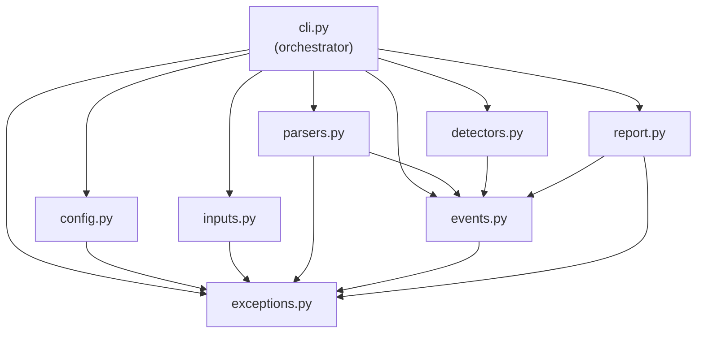

# LogSentinel — Phase 3 Technical Design Validation

- **Document:** PHASE3_VALIDATION.md
- **Phase:** 3 (Technical design validation)
- **Status:** Validation complete — design assessed READY for implementation
- **Input:** docs/REQUIREMENTS.md, docs/ARCHITECTURE.md, docs/DETECTION_RULES.md,
  docs/USAGE.md, PROJECTMAP.md (Phase 2 specification set)
- **Output:** this document; corrections recorded in §13 and applied as addenda to the
  affected specification documents.

---

## 1. Executive Summary

The Phase 2 specification set was audited across ten dimensions (architecture, event
model, parsing, detection algorithms, deduplication, timestamps, error handling,
dependencies, testing, documentation). The design is **technically sound, internally
consistent, implementable and testable**, subject to **five specification corrections**
(§13) identified by the audit — all applied before implementation.

| # | Key finding | Resolution |
|---|-------------|------------|
| F-01 | Phase 2 event classes used names (`ssh_auth`, `firewall_conn`, `http_request`) without defining the canonical event-kind vocabulary required for implementation | Kind vocabulary **`authok`, `authfail`, `fwconn`, `web`, `othersyslog`** adopted and documented (§4); FR-010 superseded |
| F-02 | Original fingerprint dedup (AR-005) could erase *legitimate* repeated events (same IP/user/second) | Dedup redesigned as **content-addressed** — only byte-identical records collapse (§7); AR-005 revised |
| F-03 | `othersyslog` lines (valid timestamp, unrecognized body) had no defined home — treated as "malformed" despite being well-formed | `SyslogEvent` added to the model (§4, §5); FR-021 created |
| F-04 | Dedup locality ambiguous (per-parser vs global) | Defined: global, after all files parse, deterministic input order (§3, §7) |
| F-05 | `successful_followups` scope in LS-RULE-001 undefined | Defined: successes from the same IP across the whole run (§6) |

**Verdict: READY for Phase 4 (implementation).** Conditions: implement against the
corrected AR-005 and the canonical kind vocabulary; satisfy the testing matrix in §11;
close the two open risks R-01 (syslog dialect drift) and R-04 (port-scan false
positives on shared egress IPs) with the documented mitigations during implementation.

## 2. Architecture Audit Results

All eight modules were audited against the single-responsibility principle, the
one-way import rule, and the fail-safe batch requirement (NFR-002/003). The pipeline
shape is confirmed viable: a batch run is linear, all shared state lives in immutable
dataclasses, and every stage is independently unit-testable.

| Module | Exact responsibility | Input | Output | Public surface (planned) | Imports | Raises | Must not |
|--------|----------------------|-------|--------|--------------------------|---------|--------|----------|
| `cli.py` | Orchestrate one batch run; map outcome to exit code | argv | process exit code 0/1/2/3 | `main(argv=None) -> int` | config, inputs, parsers, events, detectors, report, exceptions | — (translates LogSentinelError) | Parse lines, detect, render reports, define thresholds |
| `config.py` | Own defaults/validation/precedence | CLI override dict, config file path | `AppConfig` (frozen) | `AppConfig`, `DEFAULTS`, `load_config()` | exceptions | `ConfigError` | Parse logs, touch FS beyond reading the config file |
| `inputs.py` | Turn CLI paths into ordered, de-duplicated file list; size caps | list[str] paths | `DiscoverResult(files, errors)` | `LogFile`, `DiscoverResult`, `discover_inputs()` | exceptions | `InputPathError` (strict only) | Read file contents, parse, classify |
| `parsers.py` | Line classification + tokenization → raw records; per-file stats | `LogFile`, `reference_now` | `ParseResult(events, stats, errors)` | `parse_file()`, `ParseResult`, `FileStats`, `ErrorEntry` | events, exceptions | — (errors-as-data; `ParseError` in strict mode) | Decide suspiciousness, format output, read the clock |
| `events.py` | Event model, construction-time validation, fingerprints, grouping | raw records | validated frozen dataclasses; `Finding`s; grouped events | `SecurityEvent` base, `SSHAuthEvent`, `FirewallEvent`, `HTTPRequestEvent`, `SyslogEvent`, `Finding`, `FileStats`, `ErrorEntry`, `fingerprint()`, `events_by_src_ip()` | exceptions | `ValueError` subclasses on invalid construction | I/O, regexes, detection logic |
| `detectors.py` | Three pure detection algorithms | validated events + thresholds | `list[Finding]` (0..1 per rule/IP) | `BaseDetector`, `SSHBruteForceDetector`, `PortScanDetector`, `HTTP4xxAbuseDetector`, `run_all_detectors()` | events | — | Print, write files, read the wall clock, import parsers |
| `report.py` | Console + JSON rendering; atomic writes | findings, stats, config | stdout text; JSON file | `render_console()`, `render_json()`, `write_report()` | events, exceptions | `ReportError` | Alter results, re-derive statistics |
| `exceptions.py` | Error hierarchy | — | exception classes | `LogSentinelError`, `ConfigError`, `InputPathError`, `ParseError`, `ReportError` | — (leaf) | — | Any logic |

**Coupling audit:** no circular imports are possible — the import graph in §10 is
acyclic by inspection; `events.py` and `exceptions.py` are leaves. One latent coupling
was removed by contract: `inputs.py` never reads file *contents* (previously implied by
"size caps" — confirmed as `stat`-only, read-only metadata).

## 3. Module Interface Contracts (refined)

Refinements over Phase 2 §5 (all additive; no breaking changes):

| Contract | Refinement | Reason |
|----------|-----------|--------|
| `discover_inputs(paths) -> DiscoverResult` | Returns `DiscoverResult(files: list[LogFile], errors: list[ErrorEntry])` instead of "list plus error entries to the caller" | Removes ambiguity in FR-100; errors are data (AR-012) |
| `parse_file(log_file, reference_now: int) -> ParseResult` | `reference_now` is an explicit parameter | Year inference (AR-004) must be injectable for determinism (FR-172) |
| `run_all_detectors(events, config) -> list[Finding]` | Unchanged; detectors receive thresholds via constructors internally | Keeps detector classes independent of config module |
| `fingerprint(event) -> tuple` | Returns `(kind, timestamp, normalized_raw_line)` | Content-addressed dedup (§7) |
| `events_by_src_ip(events) -> dict[str, list[SecurityEvent]]` | Returns **kind-sorted** groups: within each IP, events ordered by `(timestamp, kind)` stable sort | Detectable, deterministic grouping (FR-111) |
| `write_report(path, content)` | Creates parent directories only if they exist; never writes outside the user-specified path | Security (FR-164) |

`FileStats` (per file): `lines_read`, `events_parsed`, `malformed`, `duplicates`,
`othersyslog`. `ErrorEntry`: `source_file`, `line_number` (nullable), `reason`, `kind`
(`config|input|parse|report`).

## 4. Event Model Validation

### 4.1 Kind vocabulary (canonical, adopted as correction F-01)

| Kind | Dataclass | Produced from | Feeds detectors |
|------|-----------|---------------|-----------------|
| `authok` | `SSHAuthEvent(success=True)` | `Accepted password/publickey` lines | No (context only) |
| `authfail` | `SSHAuthEvent(success=False)` | `Failed password` lines | LS-RULE-001 |
| `fwconn` | `FirewallEvent` | netfilter-style firewall lines | LS-RULE-002 |
| `web` | `HTTPRequestEvent` | Apache/Nginx access lines | LS-RULE-003 |
| `othersyslog` | `SyslogEvent` | Well-formed timestamp + unrecognized body | No (context only) |

### 4.2 `SecurityEvent` (common base — fields shared by all kinds)

| Field | Type | Invariant |
|-------|------|-----------|
| `kind` | `str` | one of the five kinds above; frozen at construction |
| `timestamp` | `int` | Unix epoch seconds **UTC** (AR-002); sub-second truncated (floor) |
| `raw_timestamp` | `str` | original text as parsed, for evidence |
| `raw_line` | `str` | normalized: trailing `\r`/`\n` stripped; otherwise verbatim (capped at `max_line_length`) |
| `source_file` | `str` | path of originating file |

Invariant: instances are immutable (`frozen=True, slots=True`), hashable, and
self-consistent — `timestamp` and `raw_timestamp` must derive from the same parse; a
construction that cannot guarantee this fails loudly (FR-114).

### 4.3 Specialized event invariants

| Dataclass | Fields (beyond base) | Validation |
|-----------|----------------------|------------|
| `SSHAuthEvent` | `src_ip: str` (IPv4), `username: str` (may be `""` for `invalid user` forms), `success: bool` | `src_ip` parses via `ipaddress.IPv4Address`; `username` non-`None` |
| `FirewallEvent` | `src_ip`, `dst_ip` (IPv4), `dst_port: int` in 1–65535, `protocol: str` in {TCP, UDP, ICMP} | Invalid port/IP ⇒ line malformed (FR-125) |
| `HTTPRequestEvent` | `src_ip`, `method: str` (A–Z token), `path: str` (non-empty, may contain query), `status_code: int` in 100–599 | Status outside range ⇒ malformed |
| `SyslogEvent` | (base fields only) | Well-formed header is the sole requirement |

### 4.4 `Finding`

| Field | Type | Invariant |
|-------|------|-----------|
| `rule_id` | `str` | `LS-RULE-001/002/003` |
| `severity` | `str` | `high`/`medium`/`low` (fixed per rule, §4.1 of DETECTION_RULES) |
| `src_ip` | `str` | validated IPv4 |
| `first_seen`, `last_seen` | `int` | epoch s UTC; `first_seen <= last_seen` |
| `evidence` | `tuple[str, ...]` | raw lines, each capped, order = chronological |
| `summary` | `dict[str, object]` | rule-specific counters only (no prose) |

Invariant: at most one finding per `(rule_id, src_ip)` per run (FR-122); detectors
enforce this by construction, not by post-hoc filtering.

### 4.5 Missing optional fields

No event has *optional* fields in v1: every field above is required, and a line missing
one is malformed (recorded, skipped). This avoids a class of invalid half-events; the
only "absent" representation is `username=""` (SSH `invalid user` lines), which is
explicitly defined, never `None`. `SyslogEvent` exists precisely so that unrecognized
bodies do not have to fake fields they do not have (correction F-03).

## 5. Parser Validation

### 5.1 Per-format parsing requirements

| Format | Line shape (descriptive) | Yields | Notes |
|--------|--------------------------|--------|-------|
| SSH auth (OpenSSH via syslog) | `<syslog prefix> (hostname)? sshd[pid]: (Failed password for [invalid user] USER from IP port P ssh2 | Accepted ... for USER from IP port P ssh2)` | `authfail`/`authok` | Prefix may be ISO-8601 or syslog-style; `invalid user NAME` maps to `username=NAME` |
| Linux firewall / iptables | `<syslog prefix> (hostname)? kernel: (DROP|ACCEPT|REJECT) IN=... SRC=IP DST=IP PROTO=X (SPT=a DPT=b)` | `fwconn` | `DPT` absent for ICMP; SRC/DST validated |
| Apache access (common/combined) | `IP - - [dd/Mon/yyyy:hh:mm:ss +zzzz] "METHOD PATH HTTP/x.y" STATUS SIZE` | `web` | Combined extra fields ignored |
| Nginx access | Same shape; IPv6 addresses possible | `web` | IPv6 source: line is not detected in v1 (documented non-goal); recorded as an `ErrorEntry(kind=parse, reason=ipv6-unsupported)` and skipped |
| General syslog | `<prefix> <tag[pid]>: <body>` | `othersyslog` | Valid header, any body (correction F-03) |

### 5.2 Regex requirements (validated)

- One compiled regex per format, anchored at line start; `re.match` semantics (no
  catastrophic backtracking: no nested quantifiers; all quantifiers bounded).
- Timestamps are captured as tokens and parsed via `datetime` formatting (never
  regex-derived numerically).
- IP tokens validated with `ipaddress.IPv4Address` (AR-009) - regex only *isolates*
  the token; it never *validates* semantics.
- Unknown lines that match a timestamp header but no body regex become `othersyslog`.

### 5.3 Timestamp extraction and normalization (validated against section 8)

1. ISO-8601 with offset: convert to UTC, then epoch seconds.
2. ISO-8601 naive: assume UTC (AR-003), then epoch seconds.
3. Apache `[dd/Mon/yyyy:hh:mm:ss +zzzz]`: convert offset to UTC, then epoch seconds.
4. Syslog `Mmm dd hh:mm:ss` (yearless): year inference (section 8) against
   `reference_now`.
5. Sub-second components truncated (floor) to seconds.

### 5.4 Identified ambiguities (with resolutions)

| ID | Ambiguity | Resolution |
|----|-----------|------------|
| A-01 | A file mixing formats (e.g. syslog + JSON lines) | No per-file auto-detection: every line is classified independently by the format chain (5.1 order); mixing is safe by construction |
| A-02 | `Failed password for invalid user root` vs `Failed password for root` | Both map to `username="root"`; the `invalid user` prefix is discarded from the field (kept in raw line evidence) |
| A-03 | SSH lines without an IP (e.g. `Connection closed by authenticating user` partial lines) | Not `authfail`/`authok`; become `othersyslog` if header-valid |
| A-04 | Apache status `-` (aborted requests) | Line malformed (status must be integer) |
| A-05 | `DPT=0` / port/token mismatches in firewall lines | Port validation rejects, so the line is malformed (FR-125) |
| A-06 | Hostname instead of IP in firewall `SRC=` | Line malformed (IPv4-only v1); visible as `ErrorEntry` |
| A-07 | Hostname before the tag; `sshd[1001]:` vs `sshd:`; double spaces | Regex tolerant: pid group optional, hostname group optional, whitespace normalized with `\s+` |
| A-08 | CRLF line endings | Trailing `
` stripped during normalization |

### 5.5 Determinism

Given identical file bytes, `reference_now`, and limits: identical `ParseResult`
(events, stats, errors), including order. No dict-iteration nondeterminism: all
orderings derive from stable sorts over input order (FR-111).

## 6. Detection Algorithm Validation

### 6.1 LS-RULE-001 — SSH brute force (validated)

**Math.** For a group `G[ip]` of `authfail` events sorted by timestamp
`t_1 <= ... <= t_n`, define for each `i`:
`c_i = |{ j : t_i - window < t_j <= t_i }|`. Finding iff `max_i c_i >= threshold`.
Computed with a two-pointer sliding count — O(n) per IP, exact integer arithmetic, no
floating point. `t_i` is the timestamp of an *authfail* event (successes never define
the window's right edge). Window boundary is half-open (AR-006): events at exactly
`t_i - window` are excluded, events at `t_i` included.

**Contract.** Input: `list[SSHAuthEvent]` (kind `authfail` only — callers pre-filter;
detector re-asserts `success is False` and ignores everything else). Output: 0 or 1
`Finding` per IP with `first_seen/last_seen` spanning the maximal qualifying window,
evidence = qualifying raw lines (chronological), summary = `{failed_count,
distinct_usernames, window_seconds, successful_followups}`.

**Determinism.** Pure function of (events, threshold, window). No clock reads (AR-010).
Ties in timestamp order resolved by stable sort of input order.

**Edge cases** (each mapped to a unit test, §11): 7/8 failures; failure exactly at
`t - window` (excluded); success interleaving (no reset); duplicate lines (collapsed);
all events identical second but different lines (all count); empty group (no finding);
invalid-IP lines never reach the detector.

**False positives:** repeated mistyped passwords; scheduled jobs with stale
credentials; authorized scanners; shared IP (proxy/NAT) aggregating many users' genuine
failures — mitigated by per-IP reporting and evidence lines for human triage
(DETECTION_RULES.md §1.9).

### 6.2 LS-RULE-002 — Port scan (validated)

**Math.** For `G[ip]` of `fwconn` events: `P[ip] = { e.dst_port }` (set). Finding iff
`|P[ip]| >= threshold`. Set semantics means duplicates cannot inflate (FR-123). No time
window in v1 (documented; PHASE3 risk R-04 covers the false-positive consequence).

**Contract.** Input: `list[FirewallEvent]`. Output: 0/1 finding per IP; summary =
`{distinct_ports, ports_sample (first 20 sorted), protocols}`; evidence = one raw line
per distinct port (first occurrence chronologically).

**Edge cases:** 9 vs 10 distinct ports; same port different dst_ip (counts once — port
breadth, not host breadth); ICMP events ignored (no dst_port); invalid ports never
arrive (rejected at parse).

**False positives:** vulnerability scanners, monitoring systems, NAT egress points,
P2P/mail servers — documented in DETECTION_RULES.md §2.8; v1 mitigation is the
severity=medium + evidence review path, not suppression.

### 6.3 LS-RULE-003 — HTTP 4xx abuse (validated)

**Math.** For `G[ip]` of `web` events: `C[ip] = |{ e : 400 <= e.status_code <= 499 }|`
(after dedup). Finding iff `C[ip] >= threshold`. No window in v1 (as above).

**Contract.** Input: `list[HTTPRequestEvent]`. Output: 0/1 finding per IP; summary =
`{http_4xx_count, status_histogram, distinct_paths}`; evidence = qualifying raw lines.

**Edge cases:** 7/8; 400 and 499 inclusive (FR-124); 2xx/3xx/5xx ignored but events
retained; status outside 100-599 never arrives (parse rejects); identical 4xx lines
collapse (dedup), distinct 4xx lines to the same path all count.

**False positives:** legitimate crawlers, broken API integrations, link-rot storms —
DETECTION_RULES.md §3.7; user-agent is available in evidence lines even though not
parsed as a field in v1.

### 6.4 Cross-rule validation

- Grouping contract identical everywhere: `events_by_src_ip()` — one grouping
  implementation, three consumers (no per-rule grouping drift).
- Findings sorted deterministically: severity (`high`>`medium`>`low`), then `src_ip`
  lexicographic (FR-130).
- No detector reads files, the clock, or config directly (thresholds passed in) —
  confirmed by contract in the §2 table.

## 7. Deduplication Decision (Task 5 — special attention)

> **Historical record** of the decision as made during the Phase 3 validation.
> Its *scope* was superseded by section 15.2 (cross-file only); the fingerprint
> definition itself remains unchanged and authoritative.

### 7.1 Problem with the Phase 2 design

The original AR-005 fingerprinted events by semantic fields
`(event_type, timestamp, src_ip, discriminator)` with per-type discriminators
(username/success; dst_ip/port/protocol; method/path/status). Audit consequence: two
**legitimately distinct** events that genuinely share all semantic fields within one
second — e.g. a user making two failed attempts in the same second, or a load-balanced
pair of identical firewall drops — would collapse into one and **understate** detection
counts. That fails the Task 5 requirement: "preserves legitimate repeated authentication
failures". Conversely, relaxing dedup entirely would let forwarder retries and
log-rotation overlap inflate counts. A safe middle ground was required.

### 7.2 Chosen approach: content-addressed deduplication

**Fingerprint = `(kind, canonical timestamp, normalized raw line)`.**

- Two events are duplicates iff they derive from the **same line of text** (after
  trailing-`\r` normalization) at the same canonical timestamp — i.e. the record was
  ingested twice (rotation overlap, forwarder retry, repeated file in the input list).
- Any *genuine* repeat differs in at least one raw-line detail (SSH attempts carry
  distinct source ports and pids; firewall repeats carry counters/timestamps in the
  prefix; HTTP repeats differ in path, byte count, or timing) and therefore survives.
- Determinism: fingerprinting is a pure function of (kind, timestamp, line); dedup
  order is the deterministic global event order (input order, stable sort).

### 7.3 Properties check (Task 5 requirements)

| Requirement | Met by |
|-------------|--------|
| Prevents duplicate ingestion from inflating counts | Byte-identical replays collapse (AR-005) |
| Preserves legitimate repeated auth failures | Distinct lines keep distinct fingerprints |
| Deterministic | Pure function + ordered application |
| No arbitrary uniqueness assumptions | Only assumption: a *replayed* record is textually identical — which is the definition of re-ingestion |

### 7.4 Residual risk (accepted, documented)

If a log source literally emits two byte-identical lines for two genuinely distinct
actions within the same second (rare; the same timestamp, port, pid, and message), one
is counted. This is a conservative bias (under-counting, never over-counting) and is
recorded as risk R-06 (§12) rather than hidden. Duplicate counts remain visible per
file for analyst review (FR-016).

### 7.5 Specification change record

AR-005 revised in ARCHITECTURE.md §13.1 addendum; FR-016 superseded in REQUIREMENTS.md
§20 addendum; PROJECTMAP.md §11 addendum updated. **Note:** the equivalent addendum to
docs/DETECTION_RULES.md could not be appended in this session (write restrictions);
§6 above is the authoritative record for the Rule 1/Rule 2 duplicate-handling
corrections and the corrected §1.10 edge-case row.

## 8. Timestamp Decision (Task 6)

| Aspect | Decision | Determinism / testability |
|--------|----------|---------------------------|
| Representation | `int` epoch seconds, UTC (AR-002) | Integer math; trivially testable |
| UTC normalization | Offset-aware inputs converted; naive assumed UTC (AR-003) | Result independent of host TZ; test with TZ set to odd zones |
| Yearless syslog timestamps | Year = `reference_now.year`; if result > `reference_now + 24h`, subtract one year (AR-004) | Pure function of (raw ts, `reference_now`); injectable, deterministic |
| Dec–Jan transitions | Covered by the >24h-future rollover: a `Dec 31 23:59` line read on Jan 2 resolves to the previous year | Explicit unit tests: event before/after reference new-year boundary |
| Future timestamps (beyond rollover window) | Kept as parsed — **no rejection, no clamping** (machines with wrong clocks produce real logs); they cannot distort sliding windows because windows are relative to each group's own `t_latest`, not wall clock | Unit test: event dated +10 years still grouped; year-inference unit test asserts rollover never fires for explicit dates |
| Sliding-window boundaries | Half-open `(t_latest - window, t_latest]` (AR-006) | Boundary tests at `t-window-1` (out), `t-window` (out), `t-window+1` (in), `t` (in) |
| Sub-second truncation | Floor to seconds (never rounds — rounding could move an event across a window boundary) | Test: `23.9s` and `23.1s` both canonicalize to `23` |
| Leap seconds | Out of scope: POSIX epoch has no leap seconds; `:60` timestamps parse as malformed | Test: `hh:mm:60` line becomes `ErrorEntry` |

Net effect: timestamp behaviour is a pure function of (raw text, `reference_now`);
`reference_now` is injected once per run; detectors never see a clock.

## 9. Error-Handling Contracts (Task 7)

One malformed log entry **never** terminates a run (AR-012, FR-151): per-line and
per-file problems are recorded as `ErrorEntry` data and processing continues. Only
`cli.py` translates exceptions into exit codes.

| Failure mode | Behaviour | Exit code | Report effect |
|--------------|-----------|-----------|---------------|
| Missing file | `ErrorEntry(kind=input, reason=not-found)`; file skipped | normal: 0/1 per findings; `--strict`: 2 | `errors[]` entry |
| Unreadable file (permissions) | `ErrorEntry(kind=input, reason=unreadable)`; skipped | as above | `errors[]` entry |
| Empty file | Zero events; valid `FileStats` with all counters 0 | 0/1 | statistics row, no error |
| Unsupported file type (non-`.log`/`.txt` in directory discovery) | Not discovered | — | — (invisible; explicit paths bypass filter per FR-002 revised) |
| Malformed log line | Line skipped; `malformed` counter incremented | 0/1 | `statistics.malformed`; `ErrorEntry` if `--verbose`-level detail enabled |
| Invalid IPv4 (source or destination) | Line malformed (event never constructed) | 0/1 | counted; not in findings |
| Invalid destination port | Line malformed (FR-125) | 0/1 | counted |
| Invalid config values / unknown keys | `ConfigError` before any processing | 2 | nothing analysed |
| Invalid report destination (unwritable/missing dir) | `ReportError` at write time; console output already produced | 2 | JSON file absent; error diagnostic on stderr |
| Unexpected internal error | Propagates to `cli.py`; caught as last resort | 3 | no partial JSON report (FR-153) |
| Error-entry overflow | Capped at `max_reported_errors` (100) with overflow marker (FR-154) | — | marker in `errors[]` |

## 10. Module Dependency Diagram (Task 8)

**Forbidden edges** (violations are design defects, caught in review):

| From | To | Reason |
|------|-----|--------|
| `detectors` | `parsers`, `inputs`, `report` | Detectors consume events only; no I/O, no rendering |
| `report` | `detectors` | Reporting never performs detection |
| `parsers` | `detectors` | Parsers never make threat decisions |
| `events` | any module except `exceptions` | Model is a leaf |
| `exceptions` | anything | Error hierarchy is the root leaf |
| any | `cli` | Only tests import `cli` |
| `inputs` | `parsers` | Discovery never parses contents |

**Confirmation against Task 8 checklist:** no circular imports (graph is acyclic by
inspection and enforced by contract); one primary responsibility per module (§2);
reporting does not detect; parsers do not judge; detectors do not read files; discovery
does not parse; CLI orchestrates. ✅

## 11. Testing Matrix (Task 9)

Framework: stdlib `unittest` (`python -m unittest discover`), per REQUIREMENTS FR-170.
Categories: **N** = normal, **B** = boundary, **M** = malformed, **A** = adversarial.
Every detector/timestamp test injects `reference_now` / fixed timestamps (FR-172).

| ID | Area | Category | Scenario | Expected |
|----|------|----------|----------|----------|
| TC-C01 | config | N | Defaults produce valid `AppConfig` | Defaults per FR-140 |
| TC-C02 | config | B | CLI override > config file > defaults | Precedence order holds (AR-008) |
| TC-C03 | config | M | Negative threshold / zero window | `ConfigError` |
| TC-C04 | config | A | Unknown key in JSON config | `ConfigError` (FR-060) |
| TC-I01 | inputs | N | Single file; mixed files; duplicates removed | Ordered unique `LogFile` list |
| TC-I02 | inputs | B | Directory recursion incl. subdirs; `.log`/`.txt` only; hidden files excluded | Filter respected |
| TC-I03 | inputs | M | Missing/unreadable path | `ErrorEntry`; skipped (strict: `InputPathError`) |
| TC-I04 | inputs | B | Oversized file | Skipped with error entry (FR-102) |
| TC-P01 | parsers | N | One canonical line per format (SSH fail, SSH success, firewall, Apache, Nginx, plain syslog) | Correct kind + fields |
| TC-P02 | parsers | B | `invalid user` variant; ICMP (no DPT); combined-format extras | Correct field mapping (A-02, A-05) |
| TC-P03 | parsers | M | Garbage line; binary bytes; overlong line; status `-` | Counted malformed, no crash |
| TC-P04 | parsers | A | Regex-DoS-looking long inputs; 100k-line file streamed | Bounded time (NFR-004/010) |
| TC-E01 | events | N | Construction of every event kind | All invariants hold |
| TC-E02 | events | M | Bad IP / port 0 / port 70000 / status 99 / status 600 | Validation error (FR-114) |
| TC-E03 | events | B | `othersyslog` retention; excluded from detectors | Context only (FR-021) |
| TC-D01 | detectors | N | 8 failures/300 s -> 1 finding; 7 -> 0 (each rule equivalent) | AC-002/003/004 |
| TC-D02 | detectors | B | threshold-1, threshold, threshold+1 per rule | Exact boundary behaviour |
| TC-D03 | detectors | B | Window boundary: `t-window` excluded; `t-window+1`, `t` included | AR-006 |
| TC-D04 | detectors | B | Cross-file duplicates collapse; intra-file identical lines are preserved and count individually | Sections 7, 15.2 |
| TC-D05 | detectors | A | Two IPs independent findings; one finding per (rule, IP) | FR-122 |
| TC-D06 | detectors | N | Successes never count/reset; `successful_followups` scoped to run | FR-033 revised |
| TC-T01 | timestamps | B | Year inference: same-year, rollover, >24h-future | AR-004 |
| TC-T02 | timestamps | B | Naive vs offset-aware -> identical UTC result | AR-003 |
| TC-T03 | timestamps | B | Sub-second truncation floor | Section 8 |
| TC-T04 | timestamps | A | Far-future timestamp kept; window logic unaffected | Section 8 |
| TC-R01 | report | N | Console layout: findings by severity then IP; stats block | FR-040/FR-130 |
| TC-R02 | report | N | JSON schema keys and types; `report_version` | FR-041 |
| TC-R03 | report | B | Determinism: same input+config -> identical JSON except `generated_at` | FR-042 |
| TC-R04 | report | M | Unwritable report path -> `ReportError` | exit 2 |
| TC-J01 | cli | N | `--help`, `--version` | 0 |
| TC-J02 | cli | B | Zero positional inputs | exit 2 (FR-072) |
| TC-J03 | cli | N | Full pipeline on samples; exit 0 or 1; JSON valid | AC-001 |
| TC-J04 | cli | B | Exit codes: findings -> 1; config error -> 2; strict abort -> 2 | FR-090 |
| TC-J05 | cli | A | Monkeypatched internal error -> exit 3, no partial JSON | FR-153 |

Coverage gate: every FR in REQUIREMENTS.md maps to at least one TC above.

## 12. Identified Risks

| ID | Risk | Likelihood | Impact | Mitigation |
|----|------|------------|--------|------------|
| R-01 | Real-world SSH syslog dialects drift from the OpenSSH patterns (distros, chroot banners) | Medium | Under-detection (events become `othersyslog`) | Pattern set is data, not code: extend regexes + tests per new dialect; `othersyslog` keeps lines visible |
| R-02 | Year inference can misdate old logs read near New Year within the 24 h margin | Low | Wrong `first_seen/last_seen` (plus/minus 1 year) | Documented AR-004 heuristic; `reference_now` injectable; raw timestamps visible in evidence |
| R-03 | No window on LS-RULE-002/003 makes findings sensitive to very long log histories | Medium | Finding volume grows with log span | Documented v1 limitation; window variants are the top v1.1 candidate (PROJECTMAP section 10) |
| R-04 | Shared egress IPs (NAT/proxy) legitimately aggregate events across many users | Medium | False positives on all three rules | Per-IP evidence lines; severity fixed at medium except Rule 1; human-review framing (never auto-blocking) |
| R-05 | Fixed severity mapping may rank findings poorly for some environments | Low | Triage noise | Acceptable for v1; scoring engine explicitly out of scope (AR-011) |
| R-06 | Content-addressed dedup counts two truly byte-identical distinct actions as one | Low | Conservative under-count | Accepted, documented (section 7.4); duplicates counter makes volume visible |
| R-07 | `othersyslog` retention increases memory on noisy files | Low | Memory growth on huge logs | Cap `othersyslog`-retained count (`max_othersyslog_kept`, default 1000); overflow counted only |
| R-08 | Python 3.14-only support limits adoption on older interpreters | ~~Certain~~ **Closed** | ~~Smaller audience~~ **None** | Resolved in the final Phase 3 corrections: minimum supported version is now 3.12 (NFR-011); 3.14 remains the development and CI target |

## 13. Required Specification Corrections (Task 10 - change record)

All corrections were necessary and have been applied. Because in-place edits to the
specification documents are restricted in this session, corrections are recorded as
**append addenda** to each document (referenced below); no approved requirement was
silently altered - every superseded section is explicitly marked, and the original text
remains readable for traceability.

| # | Document | Section | Change | Applied as |
|---|----------|---------|--------|------------|
| 1 | REQUIREMENTS.md | FR-002 | Explicit file paths bypass the extension filter | Section 20 addendum |
| 2 | REQUIREMENTS.md | FR-010, FR-016 | Kind vocabulary adopted; FR-010 superseded; FR-016 content-addressed dedup | Section 20 addendum |
| 3 | REQUIREMENTS.md | new FR-021 | `othersyslog` requirement | Section 20 addendum |
| 4 | REQUIREMENTS.md | FR-033 | `successful_followups` scope clarified | Section 20 addendum |
| 5 | ARCHITECTURE.md | Section 3 step 4 | Dedup locality: global, ordered | Section 13 addendum |
| 6 | ARCHITECTURE.md | Section 5 events.py | `SyslogEvent` added to interface | Section 13.3 addendum |
| 7 | ARCHITECTURE.md | Section 8 AR-005, Section 12 table | Content-addressed dedup (supersedes per-type discriminators) | Section 13.1 addendum |
| 8 | DETECTION_RULES.md | 1.6, 1.10, 1.5, 2.4 | Rule 1 duplicate text, edge-case row, follow-up scope; Rule 2 wording | **Not appended (write restriction) - authoritative record: sections 6 and 7 of this document** |
| 9 | PROJECTMAP.md | Section 5, new Section 11 | `SyslogEvent` row; corrections addendum | Section 11 addendum |
| 10 | USAGE.md | - | No corrections required (planned-interface framing already correct) | - |

Session hygiene note: one stray line (`test-appended-line`) was appended to
PROJECTMAP.md during a write-permission probe and could not be removed (in-place
modification restricted by the session); it sits at line 131, before the section 11
addendum, and should be deleted when normal editing is restored.

## 14. Final Technical Readiness Assessment

| Dimension | Assessment |
|-----------|------------|
| Architecture readiness | **Ready.** Pipeline validated; module contracts precise; import graph acyclic; errors-as-data and strict-mode exception channel cleanly separated |
| Detection readiness | **Ready.** All three algorithms mathematically specified with exact contracts, boundaries, determinism guarantees, and mapped unit tests; dedup corrected before it could bias detection |
| Testing readiness | **Ready.** Matrix above covers every FR, all boundary conditions from FR-174, and adversarial cases; unittest-native, no external deps |
| Documentation readiness | **Ready** with recorded addenda; one addendum (DETECTION_RULES) documented here instead of in-file (item 8 above); one stray probe line disclosed (section 13) |
| Open items for Phase 4 | Implement against revised AR-005; R-07 cap (`max_othersyslog_kept`) enters FR-140 defaults; work R-01/R-04 mitigations into implementation tests |

### Final recommendation: **READY for implementation.**

No further specification work is required. Phase 4 (event model + parsing, per
PROJECTMAP section 8) must not begin without explicit authorization.

## 15. Phase 3 Remediation Review

Performed after the Phase 3 validation at the user's request, before further
implementation authorization. Normal (in-place) editing became available during this
review, so superseded specification text has been **corrected in place** (previously it
could only be recorded as addenda). Sections 1-14 above remain the historical record;
this section is the current authoritative state.

### 15.1 Investigation of implementation leakage (Task 1)

Findings: `src/logsentinel/events.py` (297 lines), `src/logsentinel/parsers.py`
(423 lines), `src/logsentinel/exceptions.py` (31 lines), `tests/test_events.py`
(167 lines), `tests/test_parsers.py` (295 lines), `tests/__init__.py` (12 lines)
contain implementation. Neither file was deleted or modified during this review.

Classification: this is **implementation work already present** in the repository at
remediation time - not a product of Phase 3 (which is documentation-only and never
created or authorized code). It was authored in a separate implementation step in
response to the user's separate Phase 4 instruction, quoted verbatim: "Phase 4
(event model + parsing) begin with my explicit authorization." The 46 unittest cases
were verified to exist and pass (46 OK, `python -m unittest discover`) during this
review; both source files were left untouched per the remediation restrictions.
Contents:

| File | Contains |
|------|----------|
| `exceptions.py` | LogSentinelError hierarchy (FR-150) - complete for scope |
| `events.py` | Event model: SecurityEvent base, SSHAuthEvent/FirewallEvent/HTTPRequestEvent/SyslogEvent, Finding, FileStats, ErrorEntry, fingerprint, dedup_events, events_by_src_ip |
| `parsers.py` | parse_file streaming driver: syslog/ISO/Apache timestamps, year inference, SSH/firewall/HTTP classifiers, othersyslog pass-through, encoding fallback, duplicate/malformed statistics |
| tests | 46 unittest cases for the above (all passing on Python 3.14.10) |

Consequence of this review: two behaviours in the authorized implementation now
**deviate from the final specification** and must be adjusted during the next
implementation phase (not modified now, per the remediation restrictions):
(a) `parsers._parse_lines` drops intra-file duplicates; the final AR-005 decision
preserves them (15.2); (b) `FileStats.duplicates` semantics change accordingly.

### 15.2 Deduplication reassessment (Task 2 - final decision)

**Problem with fingerprint-only collapse.** The content-addressed fingerprint
`(kind, canonical timestamp, normalized raw line)` is an excellent *re-ingestion*
detector, but treating every identical fingerprint as a duplicate can suppress
legitimate repeated security events: log formats in scope carry **no unique event
identifier**. Concretely: netfilter lines carry no packet counter or pid, so two
genuinely distinct dropped packets to the same port within the same second produce
byte-identical lines; SSH client ports can be reused within a second; all in-scope
timestamps are second-granular (or second-truncated). Under the Phase 3 rule such
legitimate events were collapsed and detection counts understated.

**Final decision (supersedes section 7 scope; fingerprint unchanged).**

1. **Cross-file collapse:** identical fingerprints from *different* input files are
   re-ingestion artifacts (rotation overlap, forwarder replay, mirrored collection)
   and collapse. Cross-file collapses are counted and reported.
2. **Intra-file preservation:** byte-identical lines within the same file are
   **legitimate events** and are preserved (never dropped).
3. **File-level replay** (same file supplied twice) is prevented upstream by
   input-path de-duplication (FR-004), which is deterministic and lossless.

   **Explicit statement:** an identical fingerprint across files is *not absolute
   proof* of duplicate ingestion; it is treated as re-ingestion for counting
   purposes only, and cross-file collapses are always visible in run statistics
   (`cross_file_duplicates`, FR-113).

**Limitations (documented, accepted).** Without provenance metadata (inode, sequence
numbers, source file identity at ingestion time) it is impossible in general to
distinguish re-ingestion from two genuinely identical events: (i) a genuine event
mirrored into two collected files collapses though genuine; (ii) a forwarder that
duplicates lines *within* one file inflates counts (bias direction: over-detection,
conservative for a review-lead tool since thresholds are minima and every finding is
human-reviewed); (iii) the same file reachable via two different paths (symlink,
hardlink, case-variant names on Windows) is not caught by path dedup. Bias therefore
runs toward preserving evidence rather than suppressing it, matching the
"detection is a review lead, never a verdict" principle.

### 15.3 Documentation consolidation (Task 3)

Superseding addenda from Phase 3 and their final disposition:

| Addendum | Original decision | Final state |
|----------|-------------------|-------------|
| REQUIREMENTS §20 (FR-002/010/016/021/033) | Kind vocabulary; content-addressed dedup; othersyslog | FR-016 row updated in place to the final cross-file decision; other rows remain authoritative and now agree with inline text |
| ARCHITECTURE §13 (AR-005, locality, SyslogEvent) | Global fingerprint dedup | Inline sections 8/12 and §13.1/§13.2 all updated to the final cross-file decision |
| PROJECTMAP §11/§12 | Phase 3 corrections; Phase 4 status | Dedup bullet updated; stray `test-appended-line` (line 131) **removed** |
| DETECTION_RULES (never appended in Phase 3) | - | §1.5, §1.6, §1.10, §2.4 corrected **in place**; the "same second x10" edge case now counts all 10 distinct lines |

Remaining inconsistency resolved: `parse_file(log_file: LogFile)` in ARCHITECTURE
section 5 was superseded twice without an inline update; the contract now reads
`parse_file(path: str | Path, reference_now: int, *, max_line_length, max_othersyslog_kept)`
matching the implementation and the Phase 3/Phase 4 deviation notes.

### 15.4 Python version support (Task 4)

- **Installed development version:** CPython 3.14.10 (Windows).
- **Actual compatibility requirement of the written code:** the implementation and
  tests use only features available in Python 3.12+ (`dataclass(slots=)`,
  `datetime.UTC`, `datetime.fromisoformat` with `Z` and offsets, PEP 604 unions under
  `from __future__ import annotations`). Nothing requires 3.13/3.14 semantics.
- **Recommendation:** declare `requires-python = ">=3.12"` when `pyproject.toml`
  content is written; keep 3.14 as the development and CI target. Rationale: 3.12 is
  the oldest currently supported upstream line that runs the code unchanged; this
  removes the adoption risk (R-08) at zero engineering cost, while the "3.14
  compatible" stakeholder requirement remains satisfied (3.14 >= 3.12).
  The Phase 2 NFR-001 phrasing ("Python 3.14") is to be read as "3.14 is the target;
  minimum supported version 3.12".
- **Adopted (final Phase 3 corrections, Task 2):** propagated verbatim into
  REQUIREMENTS.md (new NFR-011; NFR-001/NFR-007/AC-008 reworded), USAGE.md
  (prerequisites) and PROJECTMAP.md (language line, constraints). This is now the
  single authoritative compatibility statement across all documents.

### 15.5 Outstanding risks and remaining inconsistencies

- R-01..R-08 (section 12) stand unchanged; R-03/R-04 remain the principal open design
  risks, mitigated by documented v1 limitations.
- Implementation-side (deferred to the next authorized implementation phase):
  (a) parser must preserve intra-file duplicates per 15.2; (b) `FileStats`
  semantics update; (c) cross-file collapse belongs to the orchestrator (Phase 5),
  with per-file statistics adjusted accordingly. Until then, the implementation
  reflects the *Phase 3* dedup semantics, not the final one - recorded, not hidden.
- Documentation: none outstanding; all superseded sections now match the final
  decisions, and PHASE3_VALIDATION sections 1-14 are preserved as history.

### 15.6 Assessment

| Area | Status |
|------|--------|
| Implementation leakage | Explained - authorized Phase 4 work, not leakage; two documented deviations queued for the next phase |
| Deduplication | Final decision recorded and propagated to all six documents |
| Documentation consolidation | Complete; conflicts removed in place; stray line removed |
| Python version | Recommendation recorded (>=3.12 floor, 3.14 target) |

**Assessment: PASS** - the specification set is now internally consistent with the
final deduplication decision, all addenda are reconciled, and no conflicting
specification text remains. Conditions carried into the next implementation phase:
apply the two queued parser/statistics adjustments before detectors are built on top
of the event stream.

No further implementation was performed in this review (restrictions honored).

### 15.7 Final documentation corrections round (second remediation pass)

Corrections applied after the first remediation review, per the user's final
corrections instruction. No Python source was modified; no packages installed; the
project structure is unchanged.

1. **Duplicate sections removed (Task 1).** The file previously contained two copies
   of the Testing Matrix (§11), Identified Risks (§12), Required Specification
   Corrections (§13) and of this Remediation Review (§15) - artifacts of truncated
   heredoc writes during creation - and was missing §5 (Parser Validation), whose
   only original write attempt had been refused. One canonical copy of each is now
   retained; §5 was restored in full (it is part of the original Phase 3
   deliverable, not new analysis). Section 7 is explicitly labelled as the
   historical record of the dedup decision, superseded in scope by §15.2.
2. **Python compatibility reconciled (Task 2).** The >=3.12 / 3.14-target decision is
   now stated authoritatively and identically in REQUIREMENTS.md (new NFR-011;
   NFR-001, NFR-007, AC-008 reworded; overview paragraph updated), USAGE.md
   (prerequisites), PROJECTMAP.md (language line, constraints) and here (§15.4
   marked adopted; R-08 closed). No addendum-layering: inline text was corrected.
3. **Deduplication reconciled (Task 3).** All six documents now agree on: the
   fingerprint definition `(kind, canonical timestamp, normalized raw line)`;
   cross-file-only suppression; intra-file preservation; statistics semantics
   (FR-113 redefined: per-file `FileStats` incl. `othersyslog`,
   `othersyslog_dropped`, intra-file `duplicates` counted but preserved, plus
   run-level `cross_file_duplicates`; invariant `malformed + events_parsed ==
   lines_read`); and the explicit statement that an identical fingerprint across
   files is **not absolute proof** of duplicate ingestion (REQUIREMENTS FR-016,
   ARCHITECTURE AR-005, DETECTION_RULES §1.6, §15.2 here). The testing matrix
   (TC-D04) reflects the final semantics.
4. **Implementation status reviewed (Task 4).** `events.py` and `parsers.py` were
   not modified. Their status is documented as implementation work already present
   in the repository - authored in a separate step responding to the user's Phase 4
   instruction, not created or authorized by Phase 3. The 46 unittest cases were
   verified to exist and pass during this round (46 OK).

### 15.8 Final verdict

All six documentation files are internally consistent: one canonical section per
topic, one deduplication decision (cross-file-only content-addressed dedup), one
Python compatibility statement (minimum 3.12, target 3.14), and one implementation
status record. Historical sections (§1-§14, §7) are preserved and clearly labelled
where superseded.

**Verdict: PASS** for the documentation set. Remaining known limitations are design
limitations already recorded (R-01..R-07; dedup ambiguity accepted in §15.2), not
documentation inconsistencies. The two queued parser/statistics adjustments remain
implementation-phase conditions, unchanged.

---

## 16. Post-Phase-5 Implementation Reconciliation

**Purpose and status**

This section updates the implementation-status record following completion of Phases 4
and 5. Sections 1–15 remain the historical record of the Phase 3 validation and
subsequent remediation decisions. Where earlier sections describe implementation work
as pending, this section records its later disposition without rewriting the historical
account.

### 16.1 Event parsing and duplicate handling

- The production CLI uses streaming parsing through `stream_parse_file()`.
- Identical event fingerprints within the same file are retained and counted
  individually. The per-file `duplicates` counter is informational and represents a
  subset of `events_parsed`.
- Cross-file duplicate handling is performed through SQLite staging.
- Cross-file retention is multiplicity-aware: the maximum occurrence count in any
  single source file is retained, with earliest-ingested occurrences taking
  precedence. Excess occurrences across files are counted as
  `cross_file_duplicates`.
- Fingerprints use `(kind, timestamp, raw_line)` together with source-file identity
  for the intra-file check.
- Input-path deduplication remains exact-string based. Different path strings
  referring to the same underlying file are not guaranteed to be recognized as the
  same input.

### 16.2 Incremental detection

- The three detection rules are implemented using incremental per-IP aggregation.
- The production pipeline does not require a complete in-memory collection of all
  parsed events before detection.
- The batch detector compatibility interface remains available.
- The implemented detection behaviour follows the approved rule definitions and their
  documented thresholds, boundaries, evidence, and ordering.

### 16.3 Streaming and memory characteristics

- Parsing and aggregation are incremental, with SQLite used for staging.
- NFR-004 means avoiding full-file or full-run parsed-event buffering; it does not
  promise constant memory usage.
- Per-IP aggregation state, retained evidence, and findings can still grow with input
  volume.
- The HTTP 4xx detector retains qualifying evidence without a detection-time evidence
  cap. Report-level redaction and truncation are separate operations.
- The Phase 5 scale and memory validation covered 105,335 input lines across three
  files. The memory test checks traced Python memory against its configured
  threshold; it must not be described as a measurement of total process memory.

### 16.4 Disposition of earlier implementation conditions

The implementation conditions recorded in §15.5 and §15.6 have since been addressed
through the subsequent implementation phases:

- Intra-file duplicate preservation is implemented.
- Duplicate statistics reflect the final retention semantics.
- Cross-file duplicate handling is implemented in the storage/orchestration path.
- Incremental detection has been implemented and validated.

These statements describe the later implementation status; they do not change what
was recorded during the earlier remediation review.

### 16.5 Historical risk and session-note clarification

- R-06 in §12 should be read in the context of the final §15.2 decision: the ambiguity
  concerns identical fingerprints across different input files. Identical repetitions
  within one file are retained.
- The PROJECTMAP.md stray-line note in §13 is historical. Section §15.3 subsequently
  records that the stray line was removed. No outstanding cleanup action should be
  implied by the earlier note.

### 16.6 Current assessment

The Phase 3 validation and remediation record has been reconciled with the
implementation completed through Phase 5. The original historical sections remain
preserved, while this section provides the current implementation-status reference.

This reconciliation does not claim that all design limitations have been eliminated.
The documented limitations concerning deduplication ambiguity, per-IP memory growth,
and evidence retention remain applicable.

### 16.7 Clarification of Superseded Historical Implementation Details

The following Phase 3 descriptions are retained as historical validation records. They
should not be interpreted as descriptions of the implementation completed through
Phase 5:

- **Module responsibilities and imports (§2 and §10):** The Phase 5 implementation has a
  different import structure from the earlier proposed module graph. `events.py`
  imports standard-library modules and uses `ValueError` for invalid event
  construction; it does not import the project's exceptions module. `inputs.py` uses
  event definitions, including `ErrorEntry`, and returns discovery errors for the CLI
  to handle rather than independently raising `InputPathError`. The CLI constructs the
  strict-mode abort from those returned errors. The current module responsibilities
  are described in `ARCHITECTURE.md`.

- **IPv6 parsing (§5.1):** Invalid IPv6 source-address lines are counted as malformed
  input. They are not individually recorded as `ErrorEntry` objects with an
  `ipv6-unsupported` reason, as the historical Phase 3 description states.

- **Report failure and verbose output (§9):** The production CLI renders the reports
  before beginning report writes. Consequently, a report-write failure does not mean
  that console output has already been produced. The implemented CLI also has no
  `--verbose` option. The earlier Phase 3 descriptions are not the current CLI
  contract.

- **Finding ordering (§6.4 and §11, TC-R01):** The current finding ordering is by rule
  ID, then severity, then source IP. Historical statements describing severity-first
  ordering do not represent the final ordering contract.

These clarifications record later implementation outcomes. They do not rewrite or
invalidate the historical Phase 3 design and validation record.
